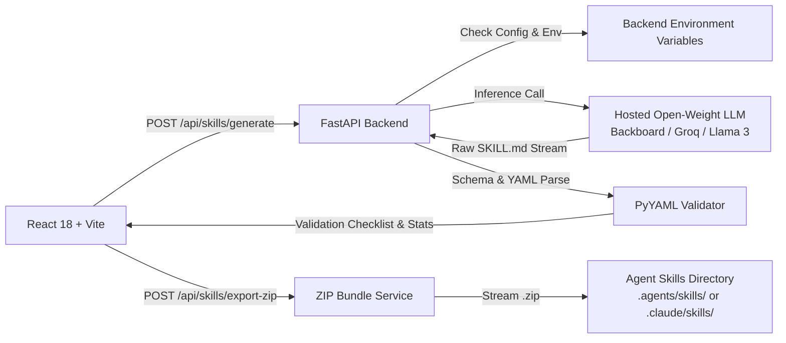

<div align="center">

# ⚡ SkillForge AI

**The Open-Source AI Agent Skill Generator for Hacktoberfest 2026**

[](https://github.com/topics/hacktoberfest-2026)
[](https://opensource.org/licenses/MIT)
[](https://fastapi.tiangolo.com)
[](https://react.dev)
[](https://vitejs.dev)
[](https://www.digitalocean.com)

*Forge production-grade, standardized `SKILL.md` capabilities for autonomous AI coding agents using hosted open-weight language models.*

</div>

---

## 🌟 Highlights

- **⚡ Hosted Open-Weight AI Generation**: Powered by high-speed inference endpoints running open-weight foundation models (Meta Llama 3.1/3.3, Mistral, DeepSeek) through Backboard, Groq, Together AI, or Hugging Face.
- **🛡️ Specification Validator**: Verifies YAML frontmatter integrity, required schema attributes (`name`, `description`), naming conventions, and structured Markdown instructions.
- **📦 Dual Export System**:
  - Direct download of standalone `SKILL.md`.
  - Comprehensive ZIP export containing `<skill_name>/` bundle with ready-to-use scaffolding (`scripts/`, `examples/`, `references/`).
- **🔒 Zero-Leakage Architecture**: API credentials remain exclusively within backend environment variables—never exposed to client browsers or bundled assets.
- **🎨 Modern Cyber Aesthetics**: Glassmorphism UI, real-time checklist validation badges, code editor tabs, and starter templates.

---

## 🏗️ Architecture



---

## 🚀 Quickstart & Local Setup

### Prerequisites
- **Python 3.11+**
- **Node.js 18+** & npm
- An API key for a hosted open-weight inference provider (Backboard, Groq, Together AI, or Hugging Face)

### 1. Clone & Environment Setup
```bash
git clone https://github.com/Jay15062006/skillforge-ai.git
cd skillforge-ai
```

### 2. Backend Setup (FastAPI)
```bash
cd backend
python -m venv .venv

# On Linux/macOS:
source .venv/bin/activate
# On Windows (PowerShell):
.venv\Scripts\Activate.ps1

pip install -r requirements.txt
cp .env.example .env
```

Edit `backend/.env` with your preferred open-weight provider:
```env
INFERENCE_PROVIDER_NAME=backboard
INFERENCE_BASE_URL=https://app.backboard.io/api
INFERENCE_API_KEY=your_api_key_here
INFERENCE_MODEL=meta-llama/llama-3.1-8b-instruct
```

Start the backend server:
```bash
uvicorn app.main:app --reload --port 8000
```
Verify the health check at [http://localhost:8000/api/health](http://localhost:8000/api/health) and interactive Swagger docs at [http://localhost:8000/docs](http://localhost:8000/docs).

### 3. Frontend Setup (React + Vite)
In a new terminal:
```bash
cd frontend
npm install
npm run dev
```
Open [http://localhost:5173](http://localhost:5173) in your browser.

---

## 🧪 Automated Testing

SkillForge AI includes automated unit and integration tests:

```bash
cd backend
.venv\Scripts\pytest
```

Tests cover:
- Health check and system metadata status.
- YAML frontmatter parsing and delimiter verification.
- Required field enforcement (`name`, `description`).
- ZIP archive generator and scaffold structure.
- Clean 503 error handling when AI providers are unconfigured.

---

## 🌊 DigitalOcean Deployment Guide

### Option A: DigitalOcean App Platform (Recommended)
1. Fork or push this repository to your GitHub account.
2. In the [DigitalOcean Cloud Console](https://cloud.digitalocean.com/apps), click **Create App** and select **GitHub**.
3. Select your `skillforge-ai` repository and the `main` branch.
4. DigitalOcean automatically detects the multi-stage `Dockerfile`.
5. Under **Environment Variables**, add:
   - `INFERENCE_PROVIDER_NAME`: `backboard` (or `groq`)
   - `INFERENCE_BASE_URL`: `https://app.backboard.io/api`
   - `INFERENCE_API_KEY`: Your hosted LLM API key (marked Encrypted)
   - `INFERENCE_MODEL`: `meta-llama/llama-3.1-8b-instruct`
   - `PORT`: `8000`
6. Click **Deploy App**.

### Option B: DigitalOcean Droplet with Docker Compose
1. Provision an Ubuntu Droplet (Basic 1GB/1CPU or higher).
2. SSH into your droplet and install Docker & Docker Compose:
   ```bash
   apt-get update && apt-get install -y docker.io docker-compose
   ```
3. Clone the repository and configure your environment:
   ```bash
   git clone https://github.com/Jay15062006/skillforge-ai.git
   cd skillforge-ai
   export INFERENCE_API_KEY="your_api_key_here"
   docker-compose up -d --build
   ```

---

## 📖 The `SKILL.md` Specification

Skills generated by SkillForge AI follow standard agentic formats:

```markdown
---
name: github-pr-reviewer
description: Automatically reviews pull requests for security flaws and code quality.
version: 1.0.0
tags:
  - git
  - code-review
  - security
---

# Overview & Capabilities
Detailed explanation of what the skill provides.

## Step-by-Step Workflow & Protocol
1. Command sequences and verification checks.
2. Tool invocations.

## Best Practices & Edge Cases
Guidelines for autonomous operation without user interruption.
```

Compatible with:
- **Google Antigravity & Agentic IDEs** (`.agents/skills/<skill>/`)
- **Claude Code** (`.claude/skills/<skill>/`)
- **Cursor / OpenDevin / AutoGen / CrewAI**

---

## 🎃 Contributing to Hacktoberfest 2026

SkillForge AI welcomes contributions for **Hacktoberfest 2026**!

1. Fork the repo and create your feature branch:
   ```bash
   git checkout -b feature/awesome-new-feature
   ```
2. Commit your changes with meaningful commit messages:
   ```bash
   git commit -m "feat(templates): add Kubernetes diagnostic skill template"
   ```
3. Ensure automated tests pass:
   ```bash
   pytest
   ```
4. Push to your branch and open a Pull Request with the `hacktoberfest-accepted` label.

---

## 📄 License

Distributed under the **MIT License**. See [`LICENSE`](LICENSE) for details.
